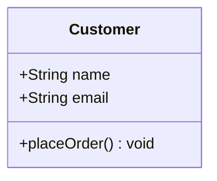

# Cartesian-Conflicts

Project Title				: Cartesian Conflicts \
Section			   	: Rubidium \
Group Members			: Bautista, Belcena, Pequiro 		\
Date (Proposal Date)		: Nov 13, 2026 

## Project Description:

### A brief summary of the project description and the need for it

  Cartesian Conflicts is an educational and turn-based game set on the lands of the Abscissa and Ordinate, an imaginary dimension governed by the realm of pure mathematics. A few months ago, bot agents known as the Astra Bots, led by the evil and manipulative SAMALT ZERO, invaded the coordinate system, threatening to replace the stability of pure mathematics maintained from generation to generation. As the Function Warden, the player needs to destroy the numerous Astra bots and eliminate the final boss. To eliminate the bots, players fire Euler-powered lasers across the graph.

  You don’t use angles to aim at the enemy but instead you use your ability to create mathematical functions to plot your attack. However, these bot agents are feeding off of these attacks to learn how to attack you against your own ability, so you would need to learn to adapt faster than these bots do. 

### Describes system components, features, and expected outputs clearly and logically. NOTE: Clearly described the elements(classes), their attributes and methods and how they will interact with each other

  The game includes a 2D coordinate grid board, player and bot health bars, a reasoning engine for the Astra Bots, and a turn based system. The expected output is a fully playable 2D game where players advance through waves of enemies using mathematical functions, adapting their equations to counter different bot formations and defensive strategies before confronting and defeating the boss to win.

### Include the description as well of your target demographics as the user of your application. 

  The primary target users are middle school, high school, and college students who are learning concepts related to algebra, geometry, pre-calculus, and some topics related to actual calculus.

### The description is then followed by the class diagram, depicting clearly what was described.

## Goals:

#### Objective 1: A functional cartesian plane (game board) that can render almost any function. 
#### Objective 2: The program can accurately evaluate the user inputs and catch syntax errors 
#### Objective 3: Program at least three distinct AstraBot profiles that can generate valid mathematical attacks based on their assigned method of attacking 
#### Objective 4: Make a complete, bug-free single-player game loop that has level progression and collision detection. 
